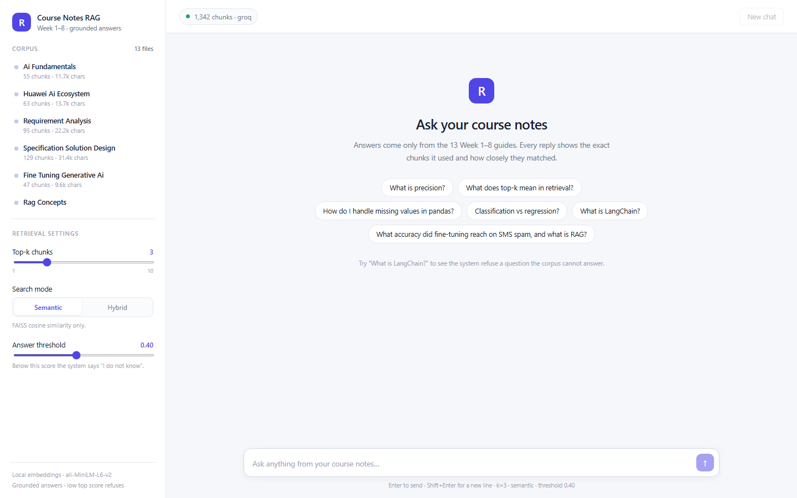
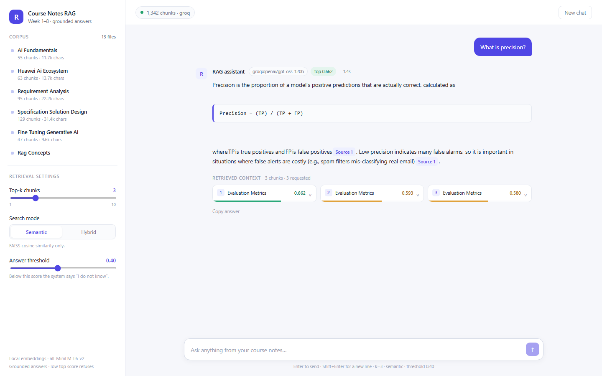
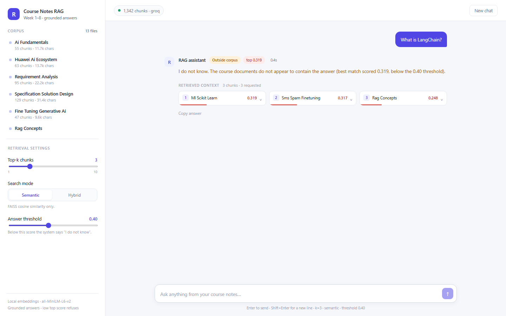
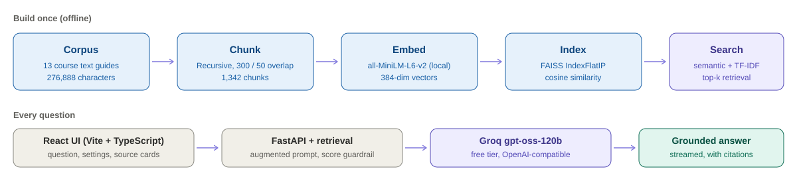

# Course Notes RAG

A full retrieval-augmented generation system built over 13 AI course guides (Weeks 1–8). Ask a question and get a **grounded answer** written by a real LLM, together with the exact chunks it used and their similarity scores. If the corpus does not contain the answer, the system says *"I do not know"* instead of guessing.

    

---

## Screenshots

**Home** — corpus list, retrieval settings and suggested questions.



**Grounded answer** — streamed from Groq, with the retrieved chunks and cosine scores shown below every reply.



**Honest refusal** — a question the documents cannot answer scores 0.319, below the 0.40 threshold, so no LLM call is made.



---

## Architecture



Embeddings and the vector index are **fully local** — no embedding API, no GPU and no vector database server. Only answer generation calls an external API (Groq's free tier). A NumPy fallback produces identical cosine scores when `faiss-cpu` is unavailable.

---

## Features

- **Exact notebook parity** — the chunker and mean-pooling embedder are ported verbatim from the original Kaggle notebook, so retrieval scores reproduce exactly.
- **Semantic and hybrid search** — FAISS cosine retrieval, plus an optional FAISS + TF-IDF hybrid mode that also matches exact words.
- **Grounded generation** — an augmented prompt instructs the model to use only the retrieved context and cite source files.
- **Score guardrail** — if the top similarity is below the threshold, the API refuses instead of hallucinating.
- **Streaming answers** — Server-Sent Events (`/api/ask/stream`) with a non-streaming fallback.
- **Provider fallback** — Groq `gpt-oss-120b` → `gpt-oss-20b` → any other provider with a key in `.env`; all through one OpenAI-compatible client.
- **React UI** — source cards with score bars, adjustable top-k / mode / threshold, document sidebar, LaTeX and citation rendering, dark-free clean light theme.
- **Deep links** — `/?q=What%20is%20precision%3F` automatically asks a question, useful for sharing and demos.
- **10 automated tests** including a live generation test.

---

## Quick start (Windows)

```bash
git clone https://github.com/ugafridi/Taking-Noted---Rag-System.git
cd Taking-Noted---Rag-System

cd backend
python -m venv .venv
.venv\Scripts\activate
pip install -r requirements.txt
copy .env.example .env      # add your GROQ_API_KEY
python -m rag.ingest        # builds the 1,342-chunk FAISS index
uvicorn app.main:app --port 8000
```

In a second terminal:

```bash
cd frontend
npm install
npm run dev
```

Or simply double-click **`start.bat`** in the project root to launch both servers.

| URL | What it is |
| --- | --- |
| `http://localhost:8000/` | Built React UI + API on one port (after `npm run build`) |
| `http://localhost:5173/` | Vite dev server with hot reload |
| `http://localhost:8000/docs` | Interactive API reference |

---

## Configuration

Copy `backend/.env.example` to `backend/.env`. Only one key is required.

| Variable | Default | Meaning |
| --- | --- | --- |
| `GROQ_API_KEY` | — | Free key from [console.groq.com/keys](https://console.groq.com/keys) |
| `LLM_PROVIDER` | `groq` | `groq`, `gemini` or `openrouter` |
| `LLM_MODEL` | `openai/gpt-oss-120b` | Primary generation model |
| `LLM_FALLBACK_MODEL` | `openai/gpt-oss-20b` | Used if the primary fails |
| `TOP_SCORE_THRESHOLD` | `0.4` | Below this, the system refuses to answer |
| `CHUNK_SIZE` / `CHUNK_OVERLAP` | `300` / `50` | Recursive chunking parameters |
| `EMBEDDING_MODEL` | `sentence-transformers/all-MiniLM-L6-v2` | Local embedding model |
| `CORS_ORIGINS` | localhost:5173 | Allowed frontend origins |

> **Never commit `.env`.** It is gitignored. The Groq free tier needs no credit card (30 RPM, 1,000 requests/day, 200K tokens/day per chat model).

---

## API

| Method | Endpoint | Description |
| --- | --- | --- |
| `GET` | `/api/health` | Index size, backend, model, threshold |
| `GET` | `/api/documents` | 13 documents with character and chunk counts |
| `POST` | `/api/search` | Retrieval only, no LLM call — ideal for debugging scores |
| `POST` | `/api/ask` | Full RAG answer with sources |
| `POST` | `/api/ask/stream` | SSE stream: `meta` → `token*` → `done` |
| `POST` | `/api/ingest` | Rebuild the index (requires `X-Admin-Key`) |

```bash
curl -X POST http://localhost:8000/api/ask \
  -H "Content-Type: application/json" \
  -d '{"question":"What is precision?","k":3,"mode":"semantic"}'
```

---

## Verified results

The backend reproduces the original notebook's saved outputs exactly:

| Check | Result |
| --- | --- |
| Corpus | 13 files, 276,888 characters |
| Chunks | 1,342 · avg 254.7 · longest 350 · shortest 8 |
| Embeddings | `(1342, 384)` |
| `What is precision?` | 0.662 — `12_evaluation_metrics.txt` |
| `What does top-k mean in retrieval?` | 0.716 — `06_rag_concepts.txt` |
| `How do I handle missing values in pandas?` | 0.695 — `08_numpy_pandas.txt` |
| `Classification vs regression?` | 0.729 — `09_ml_scikit_learn.txt` |
| `What is LangChain?` | 0.319 → refused |
| Hybrid search (combined question) | 1.690 / 1.399 / 1.318 / 1.158 / 1.101 |
| Tests | `10 passed` (includes a real Groq call) |

```bash
cd backend && pytest tests -q
```

---

## Project structure

```
backend/
  app/       config.py · schemas.py · main.py (FastAPI routes)
  rag/       chunking · embeddings · index_store · ingest · retrieve
             prompt · generate · pipeline
  data/      corpus/ (13 .txt)   index/ (generated, gitignored)
  tests/     test_parity.py
frontend/
  src/       App.tsx · api.ts · components.tsx · index.css
  dist/      production build (gitignored)
docs/        screenshots + architecture diagram
start.bat    one-click launcher (Windows)
```

`backend/data/index/` and `frontend/dist/` are generated locally and intentionally excluded from git. A fresh clone must run `python -m rag.ingest` and `npm run build`.

---

## Notes

- The 13 course guides are included so the app works out of the box. If they are not yours to share, keep the repository private.
- Free LLM tiers have no SLA and limits change; the provider layer is env-driven so switching providers needs no code changes.
- Rotate any API key that has been pasted into a chat or terminal history.
